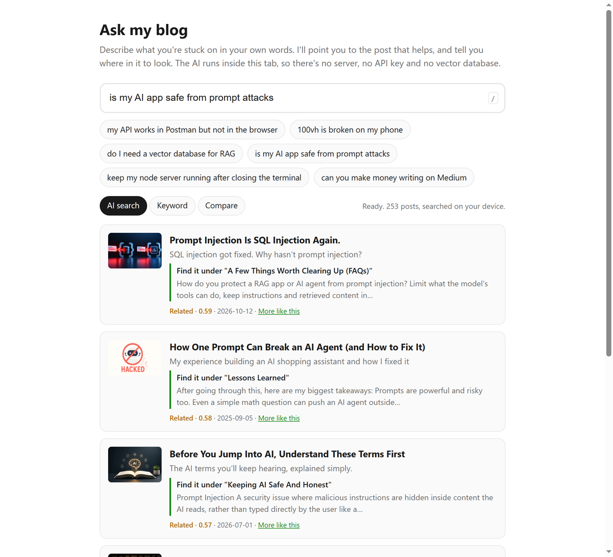
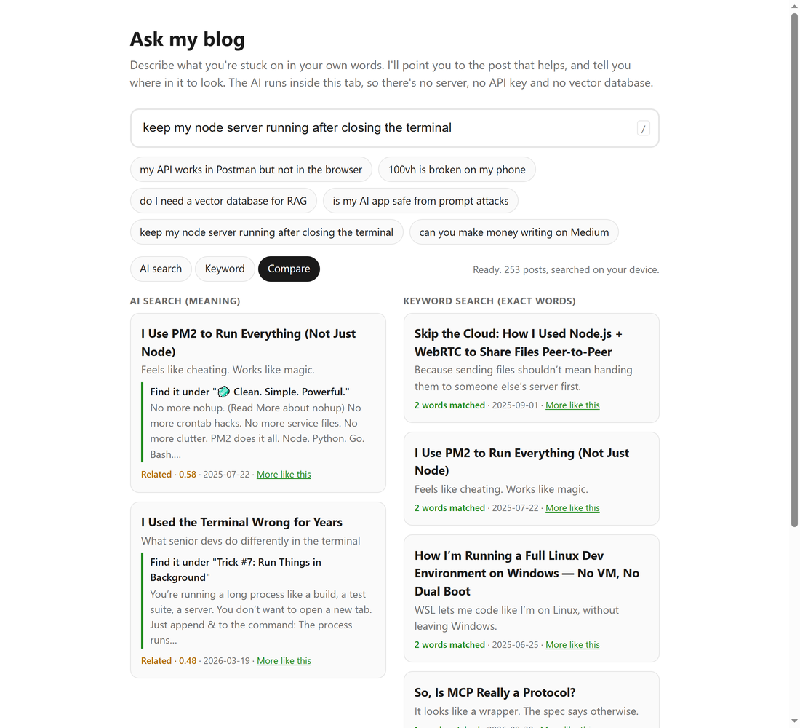
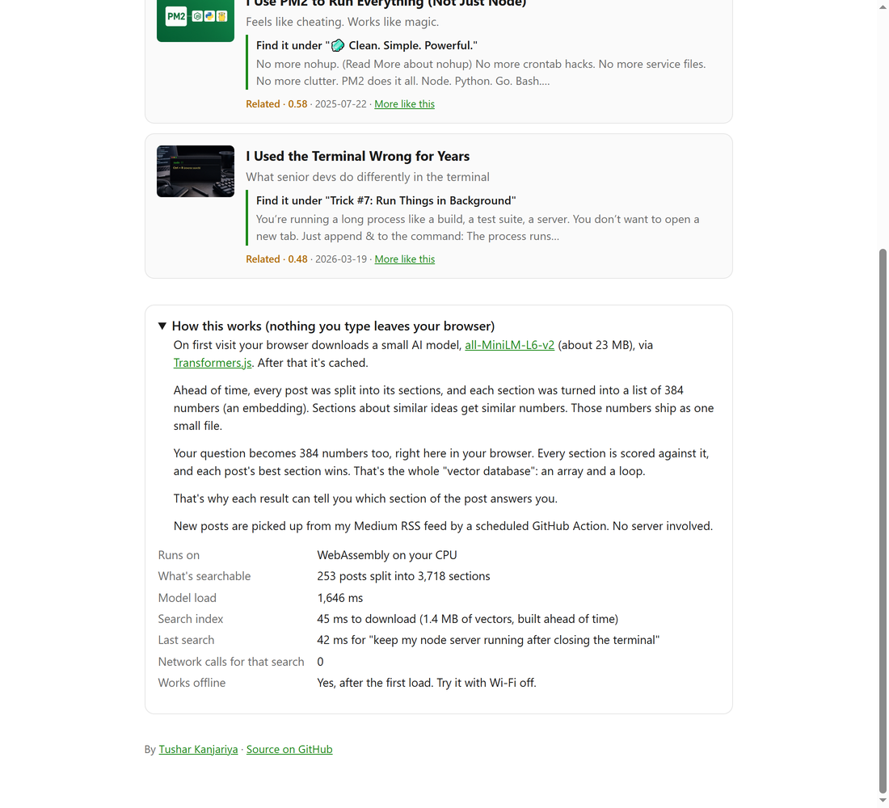

# Ask my blog: AI semantic search that runs in your browser

Search all 253 of my Medium posts by meaning, in your own words. The AI model runs inside your browser tab with [Transformers.js](https://huggingface.co/docs/transformers.js), so there's no API key, no backend and no vector database. After the first visit it works offline.

**Live demo:** https://tusharkanjariya.github.io/browser-ai-demo/



## What it does

You type a question like "my API works in Postman but not in the browser" or "keep my node server running after closing the terminal". The page finds the post that answers it and tells you which section of the post to read. Every card opens the post on Medium.

There are three modes:

- **AI search** matches by meaning.
- **Keyword** matches exact words, for comparison.
- **Compare** shows both side by side, so you can see where embeddings help.

"More like this" on any card finds related posts, and that part needs no model at all.



## How it works

```
Once, on my machine                      In your browser
───────────────────                      ───────────────
253 posts                                your question
  → split into 3,718 sections              → 384 numbers (same model)
  → 384 numbers each (all-MiniLM-L6-v2)    → dot product against every section
  → vectors.bin (int8, 1.4 MB)  ───────→   → each post's best section wins
```

1. A Node script splits each post into sections of up to about 120 words and embeds each one with [all-MiniLM-L6-v2](https://huggingface.co/Xenova/all-MiniLM-L6-v2). Each section's text is prefixed with the post title and heading, so short paragraphs keep their context.
2. The vectors are quantized to 8-bit integers and saved as one 1.4 MB file.
3. The browser downloads that file, embeds only the reader's question, and scores every section in a plain loop. That loop is the whole vector database:

```js
for (let c = 0; c < chunks.length; c++) {
  let score = 0;
  for (let k = 0; k < 384; k++) score += query[k] * vectors[c * 384 + k];
  // keep each post's best-scoring section
}
```

## Measured numbers

Measured in Chrome on a Windows machine with a 4-core CPU. WebGPU wasn't available, so everything ran on WebAssembly.

| What | Number |
|---|---|
| Model download (first visit only) | ~23 MB model + ~5 MB WebAssembly runtime |
| Model load from cache | ~1.3 to 1.7 s |
| Search index | 1.4 MB vectors + ~260 KB gzipped section list |
| One search across 3,718 sections | ~40 ms |
| Network calls per search | 0 |
| Building the index for 253 posts | ~3.5 min (Node, CPU) |

For comparison, the smallest chat models that Transformers.js can run start at 118 MB (SmolLM2-135M), and Qwen2.5-0.5B is around 500 MB. An embedding model is enough for "find the right post", and it can't invent a post that doesn't exist.



## Accuracy

`scripts/eval.mjs` runs 38 real reader questions, each paired with the post that should answer it, through the same ranking code the page uses.

- The right post ranks **first for 35 of 38** questions and in the **top 3 for 37**.
- Short name queries (PM2, CCAvenue, HTMX, WebMCP, Ollama) all rank first.
- Below a score of 0.45 the page says "I haven't written about that yet" instead of forcing a weak match. Correct answers in the test scored 0.54 or higher, and most off-topic questions I tried (Kubernetes, Rust, Postgres tuning) stayed under 0.45.

I tested a keyword boost on top of the embeddings and removed it. It didn't help name queries and slightly hurt natural questions.

## Run it locally

```bash
git clone https://github.com/TusharKanjariya/browser-ai-demo.git
cd browser-ai-demo
python -m http.server 8765
```

Open http://localhost:8765. Use a local server rather than opening the file directly, because the service worker and model cache need http.

To rebuild the index or run the tests:

```bash
npm install        # Transformers.js for Node, used only by the build scripts
npm run build      # rebuild posts.json, chunks.json and vectors.bin
npm run eval       # accuracy check
npm test           # RSS parser tests
```

## Project structure

| File | Purpose |
|---|---|
| `index.html`, `app.js` | The page: search, modes, cards, stats panel |
| `search.js` | Ranking logic, shared by the page and the accuracy test |
| `sw.js` | Service worker for offline use |
| `posts.json` | Post titles, subtitles, links, dates and key terms |
| `chunks.json` | One row per section: post id, heading, short snippet |
| `vectors.bin` | Section embeddings, int8, 384 per section |
| `scripts/build-index.mjs` | Builds the three data files |
| `scripts/sync-rss.mjs` | Adds new posts from my Medium RSS feed |
| `scripts/eval.mjs` | Accuracy test |
| `.github/workflows/sync-posts.yml` | Runs the RSS sync every 6 hours |
| `llms.txt`, `robots.txt`, `sitemap.xml` | Descriptions for search engines and AI crawlers |

The full text of my posts is not in this repo. Many of them are member-only on Medium, so the public files hold only embeddings, headings, 150-character snippets and key terms.

## Use it for your own content

The browser side doesn't care where the text comes from. To point it at your own docs or blog:

1. Produce `posts.json` and section text from your content. `parseExport()` in `scripts/build-index.mjs` reads Medium's HTML format, so swap it for a parser that fits your source (Markdown, a CMS API, a docs folder).
2. Run `npm run build` to embed the sections.
3. Put your own questions in `scripts/eval.mjs`, run `npm run eval`, and adjust the `STRONG` and `RELATED` thresholds in `app.js`. Mine come from my 253 posts and may not suit yours.

It fits anything shaped like "find the closest match": docs search, an "is this already answered?" check before a support ticket, duplicate detection, private notes search, offline apps.

## Limitations

- The first visit downloads about 28 MB. On a slow connection, keyword search works right away and AI search switches on when the model is ready.
- I haven't measured it on a low-end phone.
- New posts from RSS are indexed by title and subtitle only, until the index is rebuilt from their full text.
- WebGPU isn't used. For a model this small, WebAssembly is fast enough.

## FAQ

**Can you run an AI model in the browser without a server?**
Yes. Transformers.js downloads the model once and runs it in the tab. This demo is static files on GitHub Pages, and searches make no network calls.

**How big is the download?**
About 23 MB for all-MiniLM-L6-v2 plus about 5 MB of WebAssembly runtime, cached after the first visit.

**Does it need WebGPU?**
No. It runs on WebAssembly on the CPU, and a search takes about 40 ms.

**Do I need a vector database for semantic search?**
Not at this size. 3,718 vectors fit in a 1.4 MB file, and one loop scores all of them in about 40 ms, including embedding the question.

## About

Built by [Tushar Kanjariya](https://medium.com/@TusharKanjariya), a full-stack developer who writes about AI tooling, JavaScript and web development on Medium. This demo came out of a simple question: what's left of semantic search if you remove the API key, the backend and the vector database?

Related posts:

- [I Thought Pinecone Was Required for RAG](https://medium.com/@TusharKanjariya/i-thought-pinecone-was-required-for-rag-13c331d541c0)
- [I Don't Own a GPU. These Models Don't Care.](https://medium.com/@TusharKanjariya/i-dont-own-a-gpu-these-models-don-t-care-2c35145ba5d1)

## License

The code is under the [MIT License](LICENSE). The post data (`posts.json`, `chunks.json`, `vectors.bin`) and the articles it points to are © Tushar Kanjariya and not covered by the MIT License.
